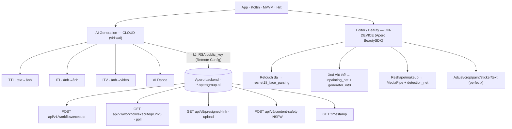

# Teardown: com.vidix.aivideogenerator.aiphotogenerator

> Phân tích tĩnh phục vụ nghiên cứu cạnh tranh. Nguồn: APK set đã giải nén tại
> `resources/` + `sources/` (Java đã decompile) + native libs, trên máy phân tích.
> Mỗi kết luận tách rõ **Quan sát** (thấy trong artifact) / **Suy luận** / **Chưa biết**.
> Không có giá trị bí mật (API key, token) nào được chép vào tài liệu này.

## 0. Sơ đồ kiến trúc

### Tính năng → Model → API

| Tính năng | Chức năng | Model / Engine | API |
|---|---|---|---|
| `Act_TTI` Text→Image | Gõ mô tả, sinh ảnh | cloud (server) | `POST workflow/execute` → poll `{runId}` |
| `Act_ITI` Image→Image | Biến đổi ảnh có sẵn | cloud | `presigned-link` → `content-safety` → `workflow/execute` → poll |
| `Act_ITV` Image→Video | Ảnh thành video | cloud | như ITI, body `ITVWorkflowRequest` |
| `ActAIDance` AI Dance | Ảnh người nhảy theo mẫu | cloud | `AIDanceWorkflowRequest` → `workflow/execute` → poll |
| Retouch da | Làm mịn/đều da | **on-device** `resnet18_face_parsing` (FaceSkinParser) | — |
| Xoá vật thể (eraser) | Xoá & lấp vùng ảnh | **on-device** `inpainting_net` + `generator_int8` (RetouchPipeline) | — |
| Reshape mặt / makeup | Chỉnh mắt/môi/mũi/mày | **on-device** MediaPipe + `detection_net` | — |
| Adjust/crop/paint/sticker/text | Sửa ảnh cơ bản (perfectx) | xử lý ảnh thường | — |
| Nội dung app | Home feed, video mẫu | — | `GET v1/screen/home`, `v1/screen/template_videos` |

**Quan sát:** mọi call cloud mang header `x-api-signature` / `x-api-timestamp` / `x-api-token` / `x-api-bundleid`, kèm `GET timestamp` đồng bộ giờ — chữ ký dựng trong `ApiSignatureUtil` (RSA, `public_key` từ Remote Config).
**Suy luận:** sinh nội dung = cloud (nặng, GPU server); beauty/retouch = on-device (nhanh, offline). Base URL generation mã hoá trong `APIEncrypted`/`SCEE`; host lộ qua content-safety là `*.aperogroup.ai`.

### Workflow, Remote Config & payload

**6 loại workflow** — ID nạp từ Remote Config (rỗng trong code → server điều khiển từ xa):
`WORKFLOW_TTI_ID` (text→image), `WORKFLOW_TTV_ID` (text→video), `WORKFLOW_ITI_SINGLE_ID` / `_MULTI_ID` (image→image 1/nhiều), `WORKFLOW_ITV_ID` (image→video), `WORKFLOW_VTV_ID` (video→video).

**Khoá Remote Config:** `API_BASEURL`, `APP_BASEURL`, `APP_NAME`, `BUNDLE_ID`, `apiKey`, `public_key`, `WORKFLOW_*_ID`.

**Payload:**
- `WorkflowRequest { workflowId, input{ files[], positivePrompt } }` (TTI)
- `ITIWorkflowRequest { workflowId, input{ files[], prompt } }`
- `AIDanceWorkflowRequest { inputImage, inputMotion, mode, positivePrompt, negativePrompt, resolution }`

---

## 1. Danh tính

| Mục | Giá trị | Nguồn |
|---|---|---|
| Package | `com.vidix.aivideogenerator.aiphotogenerator` | AndroidManifest |
| versionName / versionCode | **1.3.3 / 114** | AndroidManifest |
| compileSdk | 36 (codename 16) | AndroidManifest |
| Phân phối | **Split APK set (AAB)** — base + `config.<lang>` + `config.arm64_v8a` + `config.xxhdpi` | resources/ |
| AdMob App ID | `ca-app-pub-4584260126367940~…` (debugger meta-data) | AndroidManifest |

**Quan sát:** chỉ có ABI `arm64-v8a` trong set này → bản tải về cho máy 64-bit; không thấy `armeabi-v7a`.

## 2. Ngăn xếp kiếm tiền (monetization)

**Quan sát** — các package trong `sources/com`:

| Nhóm | SDK thấy được |
|---|---|
| Mediation | **AppLovin MAX** + **AdMob** |
| Adapter | AdColony (`jirbo`), Vungle, **Mintegral** (`mbridge`), **Pangle/ByteDance** (`bykv`, `pgl`, `tiktok`), **Meta Audience Network** (`facebook`), Vungle |
| Wrapper | **`apero`** — SDK quảng cáo của một studio VN, bọc trên AdMob/AppLovin |
| Billing | Google Play Billing (`com.android.vending.BILLING`, `CHECK_LICENSE`) |

**Suy luận:** đây là mô hình ad-mediation đầy đủ (giống chính sản phẩm của bạn), full-waterfall nhiều network. Sự có mặt của `apero` cho thấy app nhiều khả năng cùng hệ sinh thái studio VN.

## 3. Attribution & analytics

**Quan sát:** Adjust · AppsFlyer (`com.appsflyer.FacebookApplicationId`) · Facebook SDK (ApplicationId + ClientToken) · Firebase (Analytics, Crashlytics, Performance, Remote Config, Messaging, **App Check + Play Integrity**) · ByteDance **APM** (`apm`, `libapminsighta/b.so`).

**Suy luận:** đo lường rất dày — attribution kép (Adjust + AppsFlyer), và **App Check + Play Integrity** nghĩa là họ quan tâm chống lạm dụng API phía backend.

## 4. AI / xử lý ảnh trên thiết bị

**Quan sát** — native libs + assets:

| Thành phần | Bằng chứng |
|---|---|
| TensorFlow Lite + GPU delegate | `libtensorflowlite_jni.so` (4.5MB), `libtensorflowlite_gpu_jni.so` (2.6MB) |
| **MediaPipe Tasks Vision** | `libmediapipe_tasks_vision_jni.so` (**10.3MB**) |
| Model bundle | `assets/models` (**38MB**), `assets/shaders` |
| Hậu xử lý detection | `libnms.so` (NMS), `libyuv-decoder.so` |

**Model nhúng** — `assets/models` (4 file TFLite, 38MB):

| Model | Size | Vai trò (suy từ tên) |
|---|---|---|
| `generator_int8.tflite` | 12.9MB | **Sinh ảnh** (generator, int8) |
| `resnet18_face_parsing_int8.tflite` | 12.7MB | Phân vùng khuôn mặt (ResNet18 segmentation) |
| `detection_net.tflite` | 6.0MB | Phát hiện đối tượng / khuôn mặt |
| `inpainting_net.tflite` | 6.0MB | Inpainting — xoá / lấp vùng ảnh |

**Suy luận:** có **generator + inpainting + face parsing** chạy **on-device** → một phần sinh/sửa ảnh AI không cần server; model int8 để chạy nhanh trên di động.
**Chưa biết:** việc nặng (sinh video) có gọi thêm cloud không — cần xem lớp network trong `sources`.

## 5. Chống giả mạo / ký request

**Quan sát (REA + Java):**
- `libsigner.so` — ELF arm64, 1.37MB, SHA-256 `55353b75…` (evidence_id `ev_bc76ab…`). Truy trong Java: lib này thuộc **Adjust SDK** (`com.adjust.sdk.sig.Signer` + `NativeLibHelper`) — ký attribution chống gian lận, **không phải** chữ ký API generation.
- Chữ ký API generation ở `ApiSignatureUtil` — **Java thuần, không JNI**: `Cipher("RSA/ECB/PKCS1Padding")` + `public_key` (Remote Config) → `Base64 NO_WRAP`. Flow: `fetchServerTimestamp()` → `buildSignature(timestamp)` → trả `(signature, timestamp, apiKey)`.
- `libpglarmor.so` (68KB) — Pangle "armor" (chống tamper, riêng của SDK ads).

**Đính chính:** nhận định trước — "request ký ở tầng native qua libsigner" — **sai**. Chữ ký API là RSA thuần Java; `libsigner` là của Adjust. "Rút data backend" vẫn ngoài phạm vi hợp lệ, nhưng rào chắn thật là chữ ký RSA + timestamp server + content-safety, không phải native signer.

## 6. Quyền đáng chú ý

**Quan sát** — toàn bộ 30 quyền trong AndroidManifest, nhóm theo mục đích:

| Nhóm | Quyền |
|---|---|
| Media & camera | `CAMERA`, `READ_MEDIA_IMAGES`, `READ_MEDIA_VIDEO`, `READ_MEDIA_AUDIO`, `READ_MEDIA_VISUAL_USER_SELECTED` |
| Mạng | `INTERNET`, `ACCESS_NETWORK_STATE`, `ACCESS_WIFI_STATE`, `CHANGE_NETWORK_STATE` |
| Quảng cáo / Privacy Sandbox | `AD_ID`, `ACCESS_ADSERVICES_AD_ID`, `ACCESS_ADSERVICES_ATTRIBUTION`, `ACCESS_ADSERVICES_TOPICS`, `ACCESS_ADSERVICES_CUSTOM_AUDIENCE` |
| Thông báo & UI nổi | `POST_NOTIFICATIONS`, `USE_FULL_SCREEN_INTENT`, `SYSTEM_ALERT_WINDOW`, `DISABLE_KEYGUARD`, `FLAG_KEEP_SCREEN_ON`, `VIBRATE` |
| Nền & vòng đời | `RECEIVE_BOOT_COMPLETED`, `FOREGROUND_SERVICE`, `WAKE_LOCK`, `SET_ALARM` |
| Thanh toán / store | `vending.BILLING`, `vending.CHECK_LICENSE`, `finsky…BIND_GET_INSTALL_REFERRER_SERVICE` |
| Push | `c2dm.permission.RECEIVE` |
| Hãng (vendor) | `amazon.privacypass.ATTEST`, `huawei…GET_COMMON_DATA`, `samsung.mapsagent…READ_APP_INFO` |

**Suy luận:** `RECEIVE_BOOT_COMPLETED` + `FULL_SCREEN_INTENT` + `SYSTEM_ALERT_WINDOW` là bộ quyền hay dùng cho **thông báo re-engagement / màn full-screen kéo người dùng lại** — đáng soi nếu bạn so sánh chiến lược retention.

## 7. Nền tảng kỹ thuật

**Quan sát:** Dagger (DI) · Glide (`bumptech`) · Lottie (`airbnb`) · OkHttp · Room · WorkManager · Compose/emoji2 · `canhub` (image cropper) · `makeramen` (rounded image) · `lexiai`, `vidix` (package riêng của app — nhiều khả năng lớp AI/domain của họ).

## 8. REA dùng được gì ở đây

| Việc | Trạng thái |
|---|---|
| `inspect_android_package/class/method` | ❌ cần **file .apk standalone**; thư mục đã giải nén không nhận |
| `inspect_native_exports` / `open_binary` trên `.so` | ✅ chạy tốt (đã dùng cho libsigner.so) |
| Đọc manifest + `sources/` Java | đọc trực tiếp (đã decompile sẵn) |

→ Muốn dùng trọn bộ tool Android của REA thì cần **APK gốc** (một file). `pull_adb_package` kéo từ thiết bị đã cài sẽ cho file hợp lệ.

## 9. Khoảng trống cần đào tiếp

- [ ] Lớp network trong `sources` — host/endpoint app gọi, để biết AI chạy local hay cloud (§4).
- [ ] Cách `libsigner` ký request (cần `open_binary` + pseudocode native).
- [ ] Remote Config keys — chiến lược bật/tắt tính năng & quảng cáo.
- [ ] So sánh version nếu có bản APK khác (REA `compare`).
